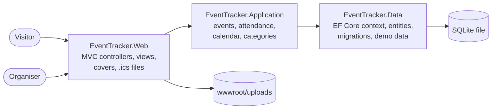

# EventTracker

**English** · [Türkçe](README.tr.md)

An event planner: create events, see them in a list or on a calendar, take registrations with a waiting list, and let people add events to their own calendar.

[](https://github.com/Beratoguzhan620/event-tracker/actions/workflows/ci.yml)


## Try it

```bash
docker compose up --build
```

Open http://localhost:8080. Without Docker, you need the .NET 10 SDK and nothing else, because the database is a single SQLite file:

```bash
dotnet run --project src/EventTracker.Web
```

The demo data holds eighteen events around today's date in Istanbul. A few are already over, and some are full with people on the waiting list. Times are planned in the `Europe/Istanbul` time zone (`Events__TimeZone`).

## Features

- **Events:**
  - Title, category, description, start and end, location, optional capacity and an optional cover image.
  - Validation messages in Turkish, next to each field.
  - A new event cannot start in the past, and must end after it starts.
- **List:**
  - Upcoming, past or all events, grouped by month.
  - Search across title, location and description. Turkish casing and accents are ignored: "istanbul" finds "İstanbul".
  - Category filter and paging.
- **Calendar:**
  - Month and week views, Monday first. On a phone both become a day-by-day agenda.
  - Events that run past midnight show on each day they touch.
- **Registration:**
  - A name and an e-mail address are enough. The same address cannot register twice for an event.
  - When the event is full, people join the waiting list and see their place in it.
  - Everyone gets a personal link to check their registration or cancel it. A cancelled seat goes straight to the first person waiting.
  - Raising the capacity moves people off the waiting list. Capacity cannot drop below the confirmed count.
- **Organiser view:** confirmed, waiting and cancelled registrations, with cancelling from the list.
- **Add to calendar:**
  - An `.ics` file for Apple Calendar and Outlook.
  - A Google Calendar link, both in UTC.

## Screenshots

| Calendar | Event |
|---|---|
|  |  |
| **Attendees** | **New event** |
|  |  |

<p align="center">
  
  
  
</p>

## How registrations stay correct

- **One seat, one person:** a registration first touches the event row, which takes SQLite's write lock. Two people cannot both see the last seat as free and take it.
- **Fair waiting list:** order is by registration time. Cancelling a seat, raising the capacity or removing the limit all promote from the front of the list in the same transaction.
- **One registration per address:** e-mail addresses are stored trimmed and lower-cased, with a unique index per event. Someone who cancelled can register again and joins the back of the queue.
- **Personal links:** each registration has a random 128-bit key, so links cannot be guessed from an id.
- **Database checks:** constraints refuse an end before the start and a capacity below one.

## Tech stack

- ASP.NET Core MVC on .NET 10, Razor views, Bootstrap 5 with a small design system ([docs/DESIGN.md](docs/DESIGN.md))
- Entity Framework Core 10 with SQLite and migrations
- xUnit with in-memory SQLite (the same engine the app uses), Playwright for UI checks
- GitHub Actions: build with warnings as errors, tests, pending-migration check, a start-up smoke test, Docker Compose and a UI preview on every pull request
- Docker / Docker Compose

## Architecture



## Settings

| Setting | Default | Meaning |
|---|---|---|
| `Database__Path` | `App_Data/eventtracker.db` | SQLite file, created on first start |
| `Events__TimeZone` | `Europe/Istanbul` | Zone events are planned in |
| `Seed__DemoContent` | `true` in Development | Fill an empty database with demo events |
| `DataProtection__KeysPath` | `data-protection-keys` | Keys for form tokens, kept across restarts |

## Tests

```bash
dotnet test
```

62 tests on an in-memory SQLite database built from the real migrations:

- **Events:** validation, past and future lists, Turkish-aware search, category filter, counts, covers, capacity changes and promotion, delete.
- **Attendance:** seats and the waiting list, duplicate and invalid addresses, finished events, cancelling by link or by the organiser, registering again after cancelling, waiting list positions.
- **Calendar:** month grids in whole weeks, week view, events over midnight, full events.
- **Calendar files:** UTC times, escaping, line folding at 75 bytes without splitting characters.
- **Demo data:** no free seats while people wait, unique addresses and keys.

The UI preview workflow goes through the main flows with Playwright at desktop and 360 px widths. It creates, edits and deletes events, registers, joins a waiting list, cancels and downloads a calendar file. It fails if a page scrolls sideways.

## Roadmap and known gaps

- Live demo.
- E-mail confirmations and reminders (the personal link is shown on screen for now).
- Organiser accounts; today anyone can manage events, as in a single-team tool.

## Background

This project started as a bootcamp project and was later rebuilt from the ground up. It used to be a CRUD screen over a list kept in memory, so everything was lost on restart. What changed:

- **Data:** EF Core with SQLite and migrations instead of a static list; categories, capacity, covers and attendees.
- **Features:** calendar views, registrations with a waiting list and personal links, calendar files, search and filters.
- **Design:** a consistent interface on a small design system, usable on phones.
- **Code:** split into Web, Application and Data projects; deletes are POST requests behind a confirmation; validation in Turkish.
- **Tests and CI:** service tests, a start-up smoke test, Docker Compose and automated UI screenshots on every pull request.

## License

[MIT](LICENSE) · Berat Oğuzhan Turğut · [GitHub](https://github.com/Beratoguzhan620)
