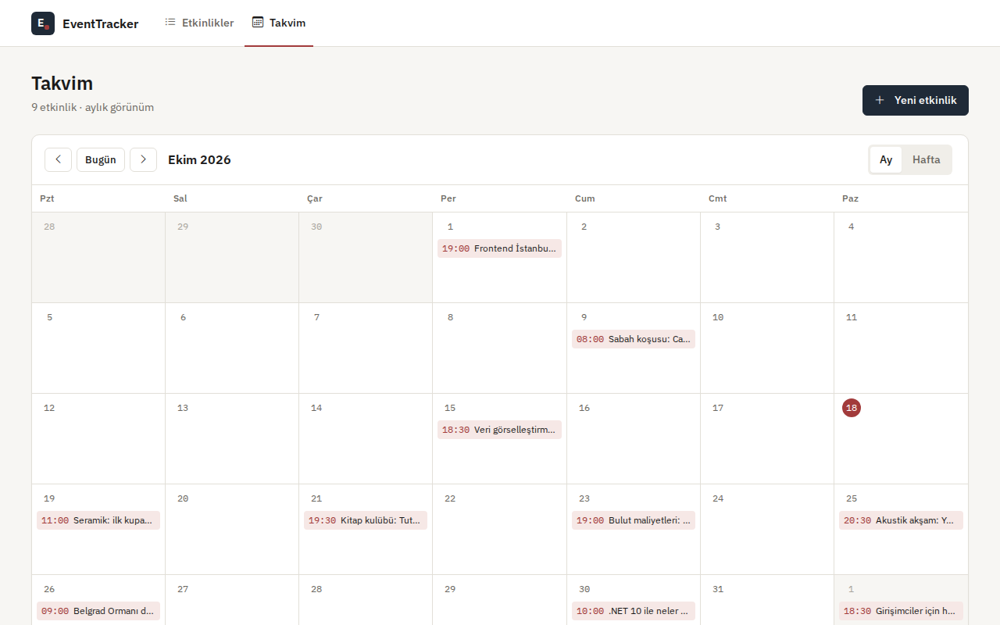
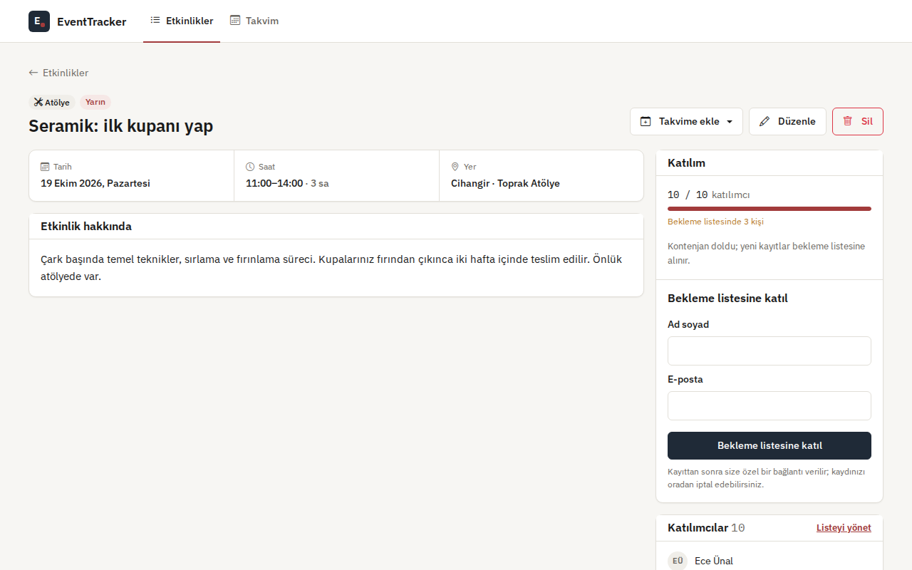
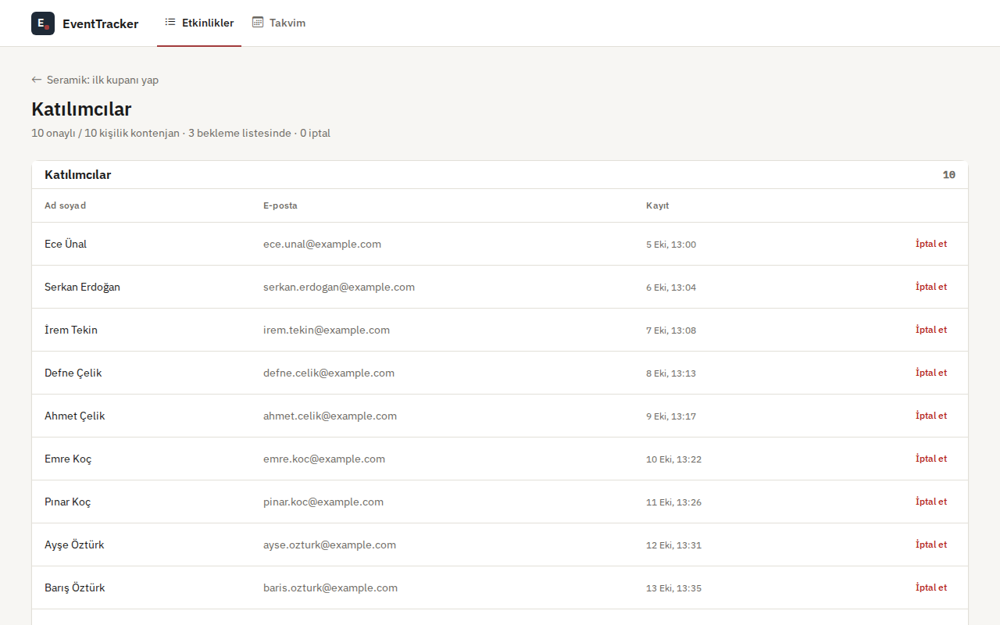
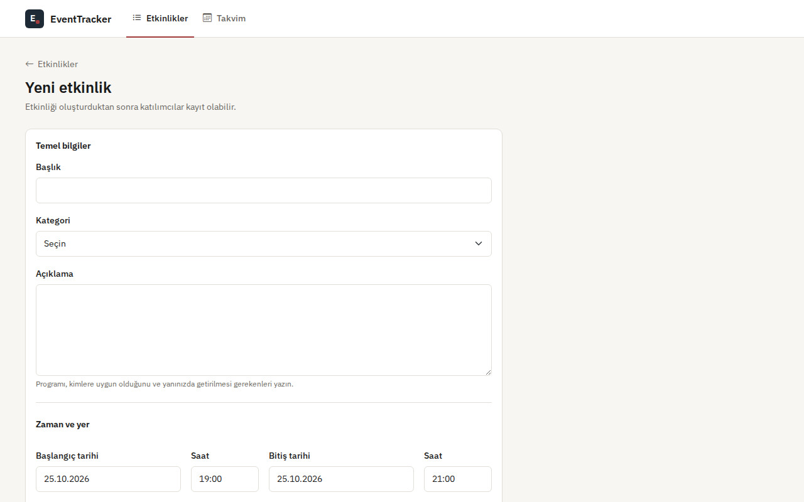
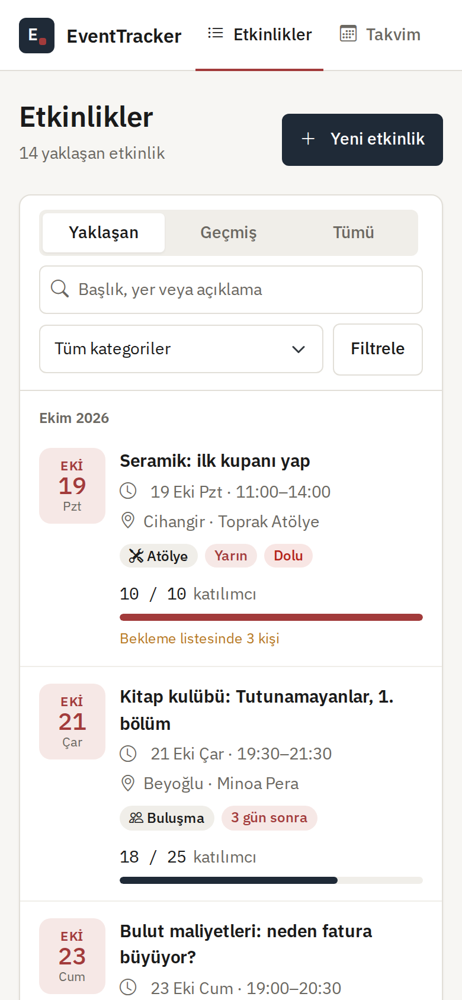
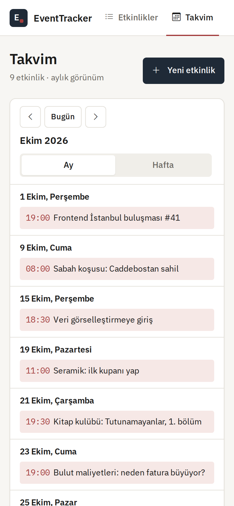
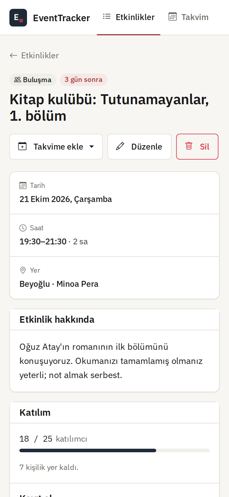
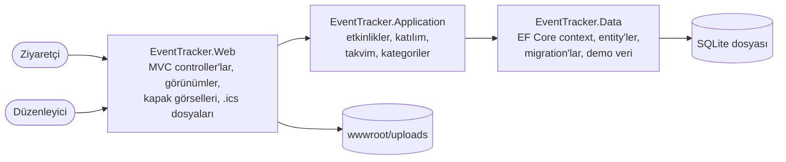

# EventTracker

[English](README.md) · **Türkçe**

Etkinlik planlayıcı: etkinlik oluştur, liste ya da takvim üzerinde gör, bekleme listeli kayıt al ve katılımcıların etkinliği kendi takvimlerine eklemesini sağla.

[](https://github.com/Beratoguzhan620/event-tracker/actions/workflows/ci.yml)


## Dene

```bash
docker compose up --build
```

http://localhost:8080 adresini aç. Docker olmadan yalnızca .NET 10 SDK yeterli, çünkü veritabanı tek bir SQLite dosyası:

```bash
dotnet run --project src/EventTracker.Web
```

Demo veride bugünün tarihi etrafında, İstanbul'da geçen on sekiz etkinlik var. Bazıları sona ermiş, bazıları dolu ve bekleme listesi oluşmuş. Saatler `Europe/Istanbul` saat dilimine göre planlanır (`Events__TimeZone`).

## Özellikler

- **Etkinlikler:**
  - Başlık, kategori, açıklama, başlangıç ve bitiş, konum, isteğe bağlı kapasite ve isteğe bağlı kapak görseli.
  - Hata mesajları Türkçe ve her alanın hemen altında.
  - Yeni bir etkinlik geçmişte başlayamaz; bitişi başlangıcından sonra olmalı.
- **Liste:**
  - Yaklaşan, geçmiş ya da tüm etkinlikler; aylara göre gruplanmış.
  - Başlık, konum ve açıklamada arama. Türkçe büyük/küçük harf ve aksanlar yok sayılır: "istanbul" yazınca "İstanbul" bulunur.
  - Kategori filtresi ve sayfalama.
- **Takvim:**
  - Pazartesiyle başlayan aylık ve haftalık görünüm. Telefonda ikisi de gün gün bir ajandaya dönüşür.
  - Gece yarısını geçen etkinlik, değdiği her günde görünür.
- **Kayıt:**
  - Ad soyad ve e-posta yeterli. Aynı e-posta bir etkinliğe iki kez kaydolamaz.
  - Etkinlik doluysa kişi bekleme listesine alınır ve kaçıncı sırada olduğunu görür.
  - Herkese kaydını görebileceği ya da iptal edebileceği kişisel bir bağlantı verilir. İptal edilen yer doğrudan bekleme listesindeki ilk kişiye geçer.
  - Kapasite artırılınca bekleme listesinden kişiler katılımcılara alınır. Kapasite, onaylı katılımcı sayısının altına indirilemez.
- **Düzenleyici görünümü:** onaylı, bekleyen ve iptal edilen kayıtlar; listeden kayıt iptali.
- **Takvime ekle:**
  - Apple Takvim ve Outlook için `.ics` dosyası.
  - Google Takvim bağlantısı; ikisi de UTC saatleriyle.

## Ekran görüntüleri

| Takvim | Etkinlik |
|---|---|
|  |  |
| **Katılımcılar** | **Yeni etkinlik** |
|  |  |

<p align="center">
  
  
  
</p>

## Kayıtlar nasıl doğru kalıyor

- **Bir yer, bir kişi:** kayıt işlemi önce etkinlik satırına dokunur; bu, SQLite'ın yazma kilidini alır. İki kişi son boş yeri aynı anda görüp ikisi birden alamaz.
- **Adil bekleme listesi:** sıra kayıt zamanına göredir. Bir yerin iptali, kapasitenin artırılması ya da sınırın kaldırılması, aynı işlem içinde listenin başındakini yukarı alır.
- **Adres başına tek kayıt:** e-posta adresleri boşlukları temizlenip küçük harfe çevrilerek saklanır ve etkinlik başına benzersiz index vardır. İptal eden biri tekrar kaydolabilir; sıranın sonuna geçer.
- **Kişisel bağlantılar:** her kaydın 128 bitlik rastgele bir anahtarı var; bağlantı bir numaradan tahmin edilemez.
- **Veritabanı kısıtları:** bitişi başlangıçtan önce olan etkinliği ve birden küçük kapasiteyi reddeder.

## Teknolojiler

- .NET 10 üzerinde ASP.NET Core MVC, Razor görünümleri, küçük bir tasarım sistemiyle Bootstrap 5 ([docs/DESIGN.md](docs/DESIGN.md))
- SQLite ve migration'larla Entity Framework Core 10
- Bellek içi SQLite ile xUnit (uygulamanın kullandığı motorun aynısı), arayüz kontrolleri için Playwright
- GitHub Actions: uyarıları hata sayan build, testler, eksik migration kontrolü, açılış smoke testi, Docker Compose ve her pull request'te arayüz önizlemesi
- Docker / Docker Compose

## Mimari



## Ayarlar

| Ayar | Varsayılan | Anlamı |
|---|---|---|
| `Database__Path` | `App_Data/eventtracker.db` | İlk açılışta oluşturulan SQLite dosyası |
| `Events__TimeZone` | `Europe/Istanbul` | Etkinliklerin planlandığı saat dilimi |
| `Seed__DemoContent` | Development'ta `true` | Boş veritabanını demo etkinliklerle doldurur |
| `DataProtection__KeysPath` | `data-protection-keys` | Form anahtarları; yeniden başlatmada korunur |

## Testler

```bash
dotnet test
```

Gerçek migration'lardan kurulan bellek içi SQLite veritabanında 62 test:

- **Etkinlikler:** doğrulama, geçmiş ve yaklaşan listeler, Türkçeyi anlayan arama, kategori filtresi, sayılar, kapak görselleri, kapasite değişikliği ve listeden yukarı alma, silme.
- **Katılım:** yerler ve bekleme listesi, tekrar eden ve geçersiz adresler, sona eren etkinlikler, bağlantıyla ya da düzenleyici tarafından iptal, iptalden sonra yeniden kayıt, bekleme listesi sırası.
- **Takvim:** tam haftalardan oluşan ay ızgarası, hafta görünümü, gece yarısını geçen ve dolu etkinlikler.
- **Takvim dosyası:** UTC saatler, kaçış karakterleri, karakterleri bölmeden 75 baytta satır katlama.
- **Demo veri:** bekleyen varken boş yer bırakılmaması, benzersiz adresler ve anahtarlar.

Arayüz önizleme iş akışı ana akışları masaüstü ve 360 px genişlikte Playwright ile gezer. Etkinlik oluşturur, düzenler ve siler; kayıt olur, bekleme listesine girer, iptal eder ve takvim dosyası indirir. Sayfa yana kayarsa başarısız olur.

## Yol haritası ve bilinen eksikler

- Canlı demo.
- E-posta ile onay ve hatırlatma (şimdilik kişisel bağlantı ekranda gösteriliyor).
- Düzenleyici hesapları; şu an tek ekiplik bir araç gibi herkes etkinlikleri yönetebiliyor.

## Geçmiş

Bu proje bir bootcamp projesi olarak başladı, sonra baştan geliştirildi. Önceden bellekte tutulan bir liste üzerinde ekleme-silme ekranıydı; uygulama yeniden başlayınca her şey kayboluyordu. Değişenler:

- **Veri:** statik liste yerine SQLite ve migration'larla EF Core; kategoriler, kapasite, kapak görselleri ve katılımcılar.
- **Özellikler:** takvim görünümleri, bekleme listeli ve kişisel bağlantılı kayıt, takvim dosyaları, arama ve filtreler.
- **Tasarım:** küçük bir tasarım sistemi üzerinde, telefonda da rahat kullanılan tutarlı bir arayüz.
- **Kod:** Web, Application ve Data projelerine ayrıldı; silme işlemleri onaydan sonra POST ile yapılıyor; doğrulama mesajları Türkçe.
- **Test ve CI:** servis testleri, açılış smoke testi, Docker Compose ve her pull request'te otomatik ekran görüntüleri.

## Lisans

[MIT](LICENSE) · Berat Oğuzhan Turğut · [GitHub](https://github.com/Beratoguzhan620)
